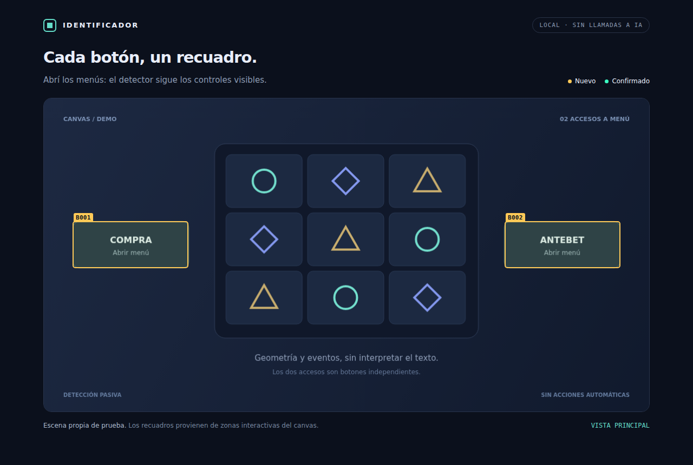
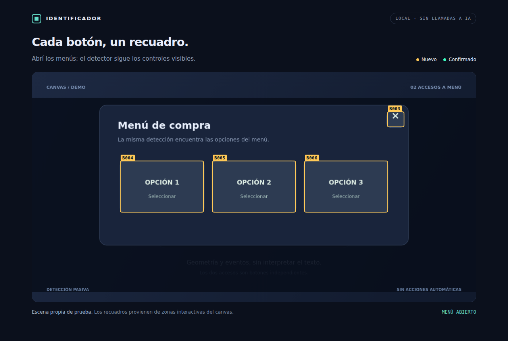

# Identificador

Detector local de **botones genéricos** para páginas y juegos HTML5. Dibuja recuadros encima de los controles, incluidos los accesos a menús de compra y antebet. Los identifica como `B001`, `B002`… con `kind: "button"`; no necesita decir qué hacen.



> La imagen corresponde a una escena propia de prueba. No es una captura de Rat Royale ni evidencia de validación en ese juego cargado.

## Inicio rápido

Requisitos: **Node.js 22 o posterior**. Windows, Linux y macOS con Chromium de Playwright.

```bash
git clone https://github.com/Shisetsu-Code/Identificador.git
cd Identificador
npm ci
npx playwright install chromium
npm run demo
```

La demo abre una ventana. Pulsá **Compra** o **Antebet**: aparecen las cajas de los controles de ese menú. La detección no depende de esas palabras. La demo no realiza apuestas.

### Sobre un juego

```bash
npm start -- --url "https://sitio.example/demo-del-juego" --scope rat-royale
```

Reemplazá la URL por el enlace real de tu demo. Dejá que cargue y avanzá las pantallas iniciales manualmente. El inspector observa la página y sus frames, y mantiene el overlay actualizado. Podés seguir usando el mouse normalmente porque las cajas no interceptan clics.

La ventana permanece abierta. Cerrala o pulsá `Ctrl+C` en la terminal para guardar el resultado. Para terminar automáticamente:

```bash
npm start -- --url "https://sitio.example/demo-del-juego" --scope rat-royale --seconds 60
```

Para ejecutar sin ventana:

```bash
npm start -- --demo --headless --seconds 3 --output output
```

El runner intenta obtener la identidad del juego desde la configuración UHT o los parámetros `symbol`/`gameSymbol`, y sigue las nuevas pestañas que abra el contexto. `--scope` fija un contexto estable por juego y evita mezclar firmas cuando distintos juegos comparten una URL de lanzamiento. Es recomendable conservar el mismo nombre entre sesiones. Los IDs `B001` son referencias de la sesión; la memoria utiliza `signature`, no esos IDs ni las coordenadas.

## Qué detecta

| Capa | Señal utilizada | Cobertura actual |
|---|---|---|
| HTML / DOM | Elementos de control, roles, handlers y listeners de clic/puntero | Controles visibles, incluidos shadow roots abiertos |
| Canvas UHT | Collider habilitado, objeto activo, handler de interacción y cámara | Adaptador basado en las APIs observadas en el HAR de Rat Royale |
| Otro canvas | Sin acceso a sus objetos interactivos | Se informa falta de cobertura; no se inventan botones |

El adaptador UHT recorre tanto la GUI como `GameRoot`, donde este juego tiene controles de compra y antebet. Calcula las cajas a partir del área interactiva y las proyecta al tamaño CSS del canvas. Comprueba visibilidad y, si está disponible, consulta el hit test del motor para filtrar controles tapados. No ejecuta sus handlers.

Al abrir un menú se detectan sus controles actuales. Al cerrarlo desaparecen sus cajas. No hay una lista de coordenadas fija por juego ni reglas de palabras como BUY, BONUS o ANTE.



## Memoria: solo los desconocidos al modelo

Se dibujan todos los botones visibles. El color **ámbar** indica una firma sin confirmar; **verde**, una firma confirmada. “Conocido” significa que esa firma ya se confirmó en ese contexto, no que se conozca la función del botón.

1. Ejecutá una observación y revisá los recuadros.
2. Confirmá todos los botones del resultado, o guardá una copia del JSON con solo los correctos:

```bash
npm start -- --learn output/all.json
```

3. Volvé a observar el mismo juego y contexto. `output/unknown.json` incluirá únicamente firmas aún no confirmadas.

Para confirmar los botones visibles al terminar una observación, existe la opción explícita `--remember`:

```bash
npm start -- --demo --headless --seconds 2 --remember
npm start -- --demo --headless --seconds 2
```

La segunda ejecución reconoce los botones confirmados. Un menú que todavía no se haya confirmado sigue produciendo desconocidos. La memoria está en `output/knowledge.json`; mantené el mismo directorio `--output` para reutilizarla. No se confirma nada automáticamente por repetición o por una puntuación de confianza.

## Archivos de salida

| Archivo | Contenido |
|---|---|
| `all.json` | Última observación: frames, todos los botones, conocidos, desconocidos y cobertura |
| `unknown.json` | JSON compacto solo con los desconocidos, listo para una futura integración con un modelo |
| `overlay.png` | Captura con recuadros, si la ventana sigue abierta al finalizar |
| `knowledge.json` | Firmas confirmadas por contexto; se crea al aprender |

Las cajas usan **píxeles CSS locales al frame**. `normalized` expresa la misma geometría entre 0 y 1. Para accionar desde otro sistema habría que transformar al frame correcto y verificar una observación actual; este proyecto únicamente observa.

Ejemplo abreviado de botón:

```json
{
  "id": "B001",
  "signature": "v1:uht:…",
  "kind": "button",
  "source": "uht",
  "box": {"x": 135, "y": 410, "width": 214, "height": 86},
  "normalized": {"x": 0.105, "y": 0.512, "width": 0.167, "height": 0.107},
  "confidence": 0.98,
  "evidence": ["uht:enabled-collider", "uht:input-handler", "uht:point-hit-test"]
}
```

La confianza indica la evidencia estructural disponible; no es una probabilidad calibrada. No se incluyen etiquetas `buy`, `antebet` o `spin`.

## HAR offline

```bash
npm start -- --har "captura.har" --scope rat-royale --seconds 60
```

La reproducción utiliza las respuestas guardadas y bloquea solicitudes que no estén en el HAR, incluidos WebSockets. No habilita una salida a internet para completar recursos faltantes. Un HAR necesita incluir todos los recursos y respuestas necesarios para cargar la página.

**El HAR aportado para este trabajo está incompleto para reproducir Rat Royale desde cero.** Faltan `desktop/build.js`, `desktop/client/resources.json` y varios fragmentos de recursos. Sirvió para identificar las APIs y la estructura de los controles; la validación del adaptador sobre el juego real cargado sigue pendiente. Más detalles en [la validación](docs/validation.md).

El archivo original, sus cuerpos de respuesta, assets y datos de sesión no están en este repositorio. Las URL exportadas omiten query, credenciales y fragmento; las capturas pueden mostrar lo que esté visible en la página y se guardan localmente.

## Integración con Playwright

Inyectá los dos scripts **antes de navegar** y en todos los frames:

```js
import { readFile } from 'node:fs/promises';
import { chromium } from 'playwright';

const browser = await chromium.launch({ headless: false });
const context = await browser.newContext();
const source = (await Promise.all([
  'src/browser/uht-adapter.js',
  'src/browser/inspector.js'
].map(path => readFile(path, 'utf8')))).join('\n;\n');
await context.addInitScript({ content: source });
const page = await context.newPage();
await page.goto('https://sitio.example/demo-del-juego');

for (const frame of page.frames()) {
  const observation = await frame.evaluate(() => __identificador.scan());
  console.log(observation.buttons);
}
```

API en cada frame:

```js
__identificador.scan();                    // Observación y actualización del overlay
__identificador.setOverlay(false);         // Ocultar recuadros
__identificador.setKnown(['v1:uht:…']);      // Colorear firmas confirmadas
__identificador.destroy();                 // Detener observación y retirar recuadros
```

Para otro motor, agregá un adaptador a `globalThis.__identificadorAdapters`. Debe devolver `{ available, buttons, warnings }`, donde cada candidato tiene `key`, `box`, `confidence` y `evidence`. El inspector deriva la firma de la identidad estructural y nunca interpreta una acción semántica.

Referencias de las APIs usadas: [Playwright `addInitScript`](https://playwright.dev/docs/api/class-browsercontext#browser-context-add-init-script) y [`routeFromHAR`](https://playwright.dev/docs/api/class-browsercontext#browser-context-route-from-har).

## Pruebas

```bash
npm test
```

**51 pruebas automatizadas verificadas.** La suite utiliza fixtures propios; no abre juegos remotos, no solicita credenciales y no ejecuta apuestas. Incluye pruebas de navegador para controles DOM, canvas, menús dinámicos, frames, memoria y exportaciones. GitHub Actions instala Chromium y ejecuta la suite.

Si ya tenés un Chromium compatible instalado, podés usar `--executable-path RUTA`; en las pruebas, `IDENTIFICADOR_BROWSER_PATH`.

## Límites actuales

- El soporte canvas inicial es **UHT**. PIXI aislado, Laya, Phaser u otros motores necesitan un adaptador; no se promete cobertura universal.
- El análisis del HAR y las pruebas de contrato no sustituyen una prueba en Rat Royale cargado.
- Los controles en shadow roots cerrados y listeners DOM registrados antes de inyectar el inspector pueden no ser visibles al detector.
- El muestreo de oclusión puede perder franjas visibles muy estrechas. Sin hit test UHT disponible se emite una advertencia.
- El escalado CSS habitual está probado. Rotación/skew del canvas y máscaras visuales complejas requieren adaptación adicional.
- Una modificación del árbol interno puede cambiar una firma y volver a producir un desconocido; esa es una decisión conservadora.
- La exportación contiene la última pantalla, no un recorrido acumulado. Se puede confirmar una pantalla con `--learn` y seguir explorando la siguiente.

No requiere OCR, GPU, Qwen ni claves de API. El detector y la memoria se ejecutan en código, sin consumir tokens de modelos.
